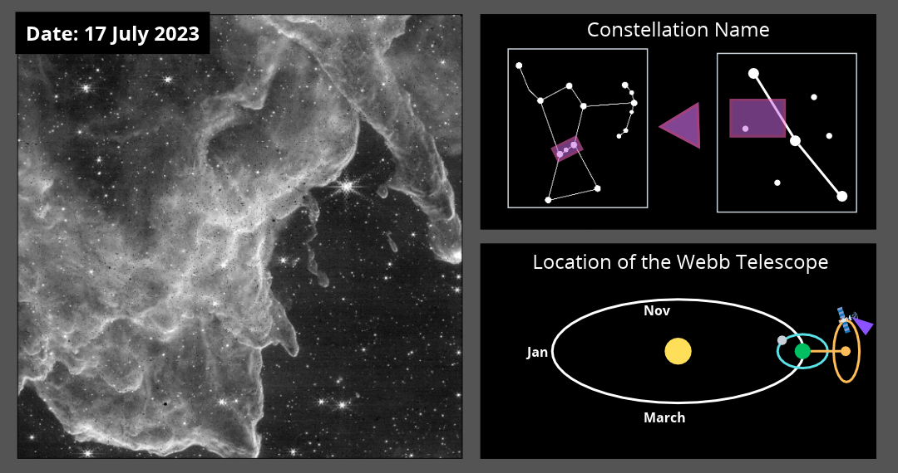

# webb-skyframe

Explore James Webb Space Telescope observations through interactive cards showing what Webb captured, where it was, and where it pointed.

Choose another public, calibrated NIRCam exposure to see its monochrome image, its field in the constellation and Webb's position at mid-exposure. The local synthetic orbital playground is implemented. Science-image rendering, collection, public service and portfolio controls remain planned.

*July design reference supplied with the checkout. The photo, date, field and orbital markers illustrate the composition.*

## Where the card will appear

On the owner's GitHub profile, everyone sees the same current card. A Next link asks the Worker to publish a complete replacement and redirects to the profile. On the bilingual Hugo/Blowfish project page at solmos.dev, a shortcode and browser JavaScript keep the current exposure in each tab. Next requests another ID, preloads the image, then swaps the image, alt text and ID together. A failed load leaves the displayed card usable.

Both surfaces use one catalog and one TypeScript SVG renderer. A Python collector prepares accepted photos, sky geometry and orbits ahead of time. A Cloudflare Worker reads a private R2 bucket. Visitors can explore the published observations while the collector is offline.

## Reproducing the work

Start with the [architecture and selection algorithm](docs/architecture.md), [card geometry and preload contract](docs/card-design.md) and [seven demonstrable increments](docs/increments.md). From the repository root, run `npm install` and `npm run dev`, then open the local URL printed by Vite. Run `npm run build` for a production build. The playground uses synthetic vectors and needs no cloud or astronomy service. Later real-data runs will record product identity, processing versions, time and frame choices, catalog revisions and source credits.

The playground will run without cloud accounts. Hosted experiments will require a GitHub profile and Actions setup, a Cloudflare account with a Worker and private R2 Standard bucket, and access to the portfolio for shortcode integration. Dependency pins, local setup and deployment commands belong to the increments that verify them.

## License and credits

Sebastian Olmos develops webb-skyframe independently of the mission and archive. The [MIT license](LICENSE) covers original software and associated documentation. Science files, derived or credited photos, catalogs, third-party icons, logos and imagery within the mockups retain their source terms. The checkout supplies the design references without individual photo or telescope-art credits. Identify their original creators and terms before reusing those elements in a production card.

Credit NASA/ESA/CSA James Webb Space Telescope observations, the observing program and team, and MAST at STScI. MAST describes most holdings as public domain and lists exceptions and mission-specific acknowledgement guidance. Carry the credit, original product URI, program and citation or dataset DOI where available with each published observation. The local example identifies program **09438**, product **jw09438007001_03103_00002_nrca3_cal.fits**, detector NRCA3 and filter F140M. [MAST product download](https://mast.stsci.edu/api/v0.1/Download/file?uri=mast:JWST/product/jw09438007001_03103_00002_nrca3_cal.fits) · [MAST data use](https://archive.stsci.edu/publishing/data-use) · [MAST attribution guidance](https://archive.stsci.edu/publishing/data-attributions)

Credit JPL Horizons for production ephemerides and each adopted sky dataset's authors and upstream catalogs. The profile interaction draws on Farlow's linked-image technique. [Horizons](https://ssd-api.jpl.nasa.gov/doc/horizons.html) · [Profile README technique](https://farlow.dev/2025/05/19/pokemon-on-github-profile)
